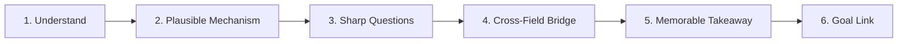

# Stark Mind 🧠⚡

> **Make curiosity more rigorous, not more verbose. Make learning more valuable, not more complicated.**

Stark Mind is an open-source, portable AI skill designed for Claude, ChatGPT, Codex, and AI coding assistants. It transforms everyday observations, questions, mistakes, systems, and passing curiosities into clear, structured, and cumulative understanding.

Inspired by the relentless curiosity, first-principles thinking, and rapid learning-from-failure associated with a famously brilliant fictional inventor—as an intellectual philosophy, not a personality imitation or role-play.

---

## 🎯 The Main Point

Most AI assistants react to everyday curiosity in predictable, frustrating ways:
- **Flattery instead of substance**: Calling ordinary questions *"fascinating!"* or *"brilliant!"*
- **Excessive verbosity**: Generating an unprompted 8-paragraph essay when all you wanted was the core mechanism.
- **Forced cross-disciplinary analogies**: Comparing a cat sitting in a small box to Docker containerization or startup pivots.
- **Unsolicited productivity traps**: Turning every casual curiosity into a startup idea, software project, or 10-step action plan.
- **Uncalibrated confidence**: Stating shaky hypotheses or invented mechanisms with absolute certainty.

**Stark Mind solves this.** It instills strict epistemic hygiene, disciplined curiosity, and adaptive depth:

| Dimension | Default LLM Behavior | With Stark Mind |
| :--- | :--- | :--- |
| **Explanation** | Long, descriptive, dictionary definitions | Causal mechanisms explained from first principles |
| **Depth** | Unpredictable, usually excessively long | **User-controlled** (`quick`, default, or `deep dive`) |
| **Analogies** | Superficial, forced across random fields | **Gated**: included only if illuminating; limits explicitly stated |
| **Uncertainty** | Hallucinates or sounds falsely confident | Explicitly declares uncertainty and suggests verification |
| **Curiosity** | Converts every thought into a work project | Values exploration for its own sake without forced productivity |
| **Mistakes** | Offers patronizing reassurance or lectures | Conducts blameless root-cause analysis and extracts reusable rules |

---

## 🔄 The 6-Step Exploration Process

When activated by an observation or curiosity, Stark Mind navigates through a disciplined 6-stage framework:



1. **Understand**: Separates what was actually observed from assumptions or interpretations.
2. **Explain, then look wider**: Clarifies the simplest plausible mechanism first. Additional angles are only explored when warranted.
3. **Ask better questions**: Highlights hidden constraints, trade-offs, feedback loops, and failure modes. **Capped at at most one targeted follow-up question.**
4. **Connect ideas (gated)**: Identifies cross-disciplinary principles *only* when they add genuine explanatory power, explicitly marking where the analogy breaks down.
5. **Find a useful takeaway**: Distills a compact mental model or rule of thumb. Insights stand on their own—no forced action items or homework.
6. **Connect to goals (conditional)**: Links the takeaway to the user's stated interests only if a genuine, non-trivial connection exists.

---

## 🎚️ User-Controlled Depth

You dictate the cognitive load and verbosity using simple keywords:

- **`quick` / `tldr` / `in a sentence`**: 1–3 sentences focusing strictly on the root mechanism. No follow-ups, no homework.
- **Default (no keyword)**: 2–4 concise paragraphs, exploring the mechanism and a deeper pattern. At most one optional follow-up question.
- **`deep dive` / `explain fully`**: Comprehensive analysis, exploring trade-offs, edge cases, underlying evidence, and optional real-world experiments.

---

## 💡 Real-World Example

**Observation:**
> *"A restaurant owner remembers what regular customers usually order."*

**Default Assistant Response:**
> *"That's a brilliant observation! It touches on psychology, economics, hospitality, and computer science. Have you considered building an AI-powered CRM app for local diners? Here is a 10-step startup plan..."*

**Stark Mind Response:**
> Being recognized saves the customer effort (no need to explain the order again) and signals that they matter, which builds loyalty.
>
> Software does the same thing with stored preferences. The analogy holds for the friction savings, but it breaks at judgment: the owner knows when *not* to mention what they remember, and an automated system usually doesn't. That is where helpful memory turns into tracking.
>
> A rule to keep: *good personalization removes friction and leaves the person in control of what is remembered.*

---

## 📦 Installation & Setup

Stark Mind follows the [`agentskills.io`](https://agentskills.io) open standard (`SKILL.md` with YAML frontmatter).

### 1. Claude Code, Codex CLI, or AGY
Copy or clone the folder directly into your workspace or global skills directory:
```bash
# For Claude Code
mkdir -p .claude/skills/stark-mind
cp SKILL.md .claude/skills/stark-mind/

# For OpenAI Codex CLI
mkdir -p .codex/skills/stark-mind
cp SKILL.md .codex/skills/stark-mind/

# For AGY (Antigravity)
mkdir -p .agents/skills/stark-mind
cp SKILL.md .agents/skills/stark-mind/
```
The skill automatically activates via progressive disclosure whenever you share an observation or curiosity.

### 2. Claude.ai Projects
1. Open your Claude.ai Project.
2. In the right sidebar under **Project Knowledge**, upload [`SKILL.md`](SKILL.md).
3. The skill rules now automatically guide interactions within that project.

### 3. ChatGPT Custom GPTs
1. Go to **ChatGPT > Explore GPTs > Create**.
2. Switch to the **Configure** tab.
3. Upload [`SKILL.md`](SKILL.md) into **Knowledge**, and put one line in **Instructions**: "Follow the Stark Mind skill in SKILL.md for observations and curiosities."

   Do not paste the full file into **Instructions**: `SKILL.md` is about 15,000 characters, and the Instructions box has a character limit (8,000 at the time of writing) that would cut it off.

### 4. Custom Instructions / Any Assistant
Copy the text of [`SKILL.md`](SKILL.md) into your assistant's system prompt. Check the field's character limit first; many Custom Instructions fields are shorter than this file.

---

## 🧪 Evaluation Suite

Prompt engineering without empirical evaluation produces untested assumptions. This repository includes a 22-scenario test suite and a trigger set in [`evaluation/test_cases.md`](evaluation/test_cases.md), with recorded results in [`evaluation/results/v2/scores.md`](evaluation/results/v2/scores.md):

- **T1–T3**: Tests everyday observations and filters out forced analogies.
- **T4–T6**: Tests technical causal accuracy, blameless failure post-mortems, and verification of surprising claims.
- **T7–T9**: Tests ambiguous inputs, prevents unnecessary web browsing, and verifies research-critical topics.
- **T10–T12**: Tests non-career curiosities, strict adherence to `quick` brevity cues, and honest calibration of uncertainty.
- **T13–T22**: Tests deep-dive mode, successes, high-stakes topics, an overwhelmed user, wrong assumptions, role-play requests, injected instructions, "what if" questions, saving a discovery, and a task that is not a curiosity.
- **Trigger set**: Prompts that should and should not activate the skill.

Responses are evaluated against an 8-dimension rubric: *Factual Reliability*, *Reasoning Quality*, *Connection Relevance*, *Uncertainty Calibration*, *Conciseness*, *Learning Value*, *Respect for Intent*, and *Appropriate Tool Use*.

---

## ⚠️ Honest Limitations

- **Prompt-level instructions**: Stark Mind guides model behavior; it cannot fix underlying reasoning limitations or hallucinations inherent to the base model.
- **Stateless environments**: Persistent memory across conversations depends on platform capabilities (Claude Projects, ChatGPT memory, local files). In stateless chats, the skill offers a copy-pasteable note format instead of pretending memory exists.
- **Context token footprint**: The complete `SKILL.md` consumes ~3,600 tokens of context.

---

## 📄 License & Contributing

- **License**: MIT License. See [`LICENSE`](LICENSE) for details.
- **Contributions**: Pull requests and issue reports are welcome. When proposing rule changes, please verify them against the test cases in [`evaluation/test_cases.md`](evaluation/test_cases.md).
